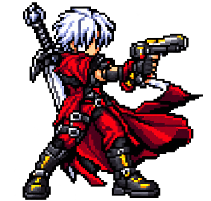
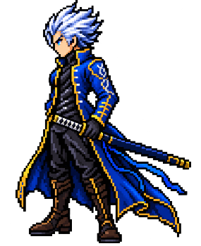

<table align="center">
  <tr>
    <td align="left" valign="middle">
      
    </td>
    <td align="center" valign="middle">
      <h1><code>> HE'YA I'M DARIO HUERTA</code></h1>
      
      <br /><br />
      <a href="https://www.linkedin.com/in/matias-dario-huerta-cruz-76b059355/"></a>
      <a href="https://www.instagram.com/dario.h.c/"></a>
      <a href="mailto:matihuerta.c@gmail.com"></a>
      <a href="https://github.com/dariohuerta84"></a>
    </td>
    <td align="right" valign="middle">
      
    </td>
  </tr>
</table>

<p align="center">
  
</p>

## <code>> ABOUT_ME.exe</code> <picture></picture>

🎓 **Informatics Engineering Student (8th Semester)** at **Universidad Peruana Cayetano Heredia (UPCH)** — Lima, Peru.

🚀 **Building at the intersection of AI & 3D Vision, Full-Stack Software Engineering, and DevSecOps:**
- **Artificial Intelligence & 3D Vision (`L.I.A. UPCH`):** Member & former Rotating Researcher at UPCH's AI Lab. Architecting hybrid **Edge → VLM** 3D spatial perception gates (`MyLeenTo3`), RAG + Function Calling agents (`RutaSegura`, `AMPARA 2.0`), and optimizing multi-stage Docker pipelines (**-60% LLM compute overhead** across **15 concurrent projects**).
- **Full-Stack Software & QA:** Shipping type-safe web and mobile systems (`React 19`, `Three.js`, `TypeScript`, `FastAPI`, `NestJS`, `PostgreSQL/PostGIS`) backed by deterministic automated testing (**82 Pytest tests** in `OdysMedic`, **71 Pytest tests** in `MyLeenTo3`).
- **Cybersecurity & Linux Hardening:** Ethical Hacking, PenTesting in Linux (`Kali` / `BlackArch`), network defense, container isolation (non-root Docker architectures on `HINTON 1 & 2`), and workstation tuning on EndeavourOS / Arch Linux (`Hyprland`).
- **Leadership & Mentorship (`LEAD UPCH`):** Lead of the Professional Development Pillar, training incoming freshmen in technical & soft skills and mentoring 3 students in drafting their first scientific paper.

```text
dario@archlinux:~# neofetch
OS: Arch Linux x86_64 (EndeavourOS)
WM / Shell: Hyprland (Wayland) · zsh (Caelestia-Shell)
Role: AI, Software & Cybersecurity Engineer @ L.I.A. UPCH
Leadership: Professional Development Lead @ LEAD UPCH
Focus: 3D Vision & VLMs | Multi-Agent AI | Full-Stack | DevSecOps
```

<p align="center">
  
</p>

## <code>> FEATURED_PROJECTS.dir</code>

| Project | Domain | Architecture & Verified Impact |
| :--- | :--- | :--- |
| [**`MyLeenTo3`**](https://github.com/dariohuerta84/MyLeenTo3) | `3D Vision · Edge → VLM` | Monocular 3D spatial perception & deterministic physics reliability gate (**MoGe-2 + YOLOE-OV** → **Google AI Studio**), 360° SIFT+Sim(3)+ICP fusion, **React 19 + Three.js**, **FastAPI**, **71/71 Pytest**. *(3D evolution of C8286)*. |
| [**`OdysMedic`**](https://github.com/dariohuerta84/OdysMedic) | `Full-Stack · EdTech` | Adaptive clinical training platform (**BioIncubadora Cayetano 2026**) with OCRI taxonomy & Ebbinghaus spaced repetition; **React 18 + TypeScript + FastAPI + SQLAlchemy 2.0**, **82 Pytest tests**. |
| [**`HeredIAns (RutaSegura)`**](https://github.com/dariohuerta84/HeredIAns) | `AI Agents · GIS` | Autonomous **Gemma / Gemini Function Calling** + regulatory RAG agent analyzing **75,400+** official road safety records (ONSV / MTC / SUTRAN) on **React 19 + FastAPI + Leaflet GIS**. |
| [**`C8286-Vision-Clasica-vs-CNN`**](https://github.com/dariohuerta84/C8286-Proyecto1-Vision-Clasica-vs-CNN) | `Parallel Computing · HPC` | Parallelized classical vision (`POSIX SharedMemory / loky`) vs **MobileNetV2 (CUDA RTX 3050 NVML / TFLite INT8)**, adaptive cascades, 95% Bootstrap CIs, 14-page report & **13/13 CI tests**. |
| [**`QUIM-DETECT2`**](https://github.com/dariohuerta84/QUIM-DETECT2) | `ML · Embedded Hardware` | Portable VIS/NIR spectroscopy pesticide detector (`AS7343`, 350–1000 nm) powered by **304 supervised ML models** (SVM, Random Forest, ANN) with automated stepper/servo sample capture. |
| [**`gestion_hinton`**](https://github.com/dariohuerta84/gestion_hinton) | `DevOps · Infrastructure` | Modular multi-container Docker ecosystem for ML, PyTorch & Computer Vision workloads across **HINTON 1 & 2** lab compute servers. |

<p align="center">
  
</p>

## <code>> CERTIFICATIONS.sys</code>

<p align="left">
  <a href="https://www.credly.com/badges/c544d7b5-68c9-4da3-8221-79aa1984c1a8" target="_blank"></a>
  <a href="https://www.credly.com/badges/1759f41d-88d2-4777-83cb-0a7eefe38732" target="_blank"></a>
  <a href="https://www.credly.com/badges/d67bc43a-ab22-485c-97ec-b95da4ef7f1e" target="_blank"></a>
  <a href="https://www.credly.com/badges/548f4a39-76ae-4787-8809-d601fc453018" target="_blank"></a>
  <a href="https://www.credly.com/badges/a3000869-7d7d-484a-99d2-1bab4eed292a" target="_blank"></a>
  <a href="https://www.credly.com/badges/0e40273e-d2ed-4a06-9ca0-662220a370f8" target="_blank"></a>
  <a href="https://www.coursera.org/account/accomplishments/verify/DN5A87XUN9I4" target="_blank"></a>
</p>

<p align="center">
  
</p>

## <code>> TOOLS_&_TECHNOLOGIES.log</code>

### <code>[+] AI, 3D Vision & Data Science</code>
<p align="left">
  
  
  
  
  
  
  
  
  
</p>

### <code>[+] Backend, Databases & Testing</code>
<p align="left">
  
  
  
  
  
  
  
  
  
  
  
</p>

### <code>[+] Frontend & 3D Web Development</code>
<p align="left">
  
  
  
  
  
  
  
  
</p>

### <code>[+] Cybersecurity, DevOps & Cloud</code>
<p align="left">
  
  
  
  
  
  
  
  
</p>

<p align="center">
  
</p>

## <code>> ACHIEVEMENTS.dat</code>

- 🥈 **2nd Place (Silver Medal) at XIX KIWIE 2026** – *Korean Intellectual Property Office (KIPO) & INDECOPI — Seoul, South Korea*
- 🎤 **Speaker at UNICTEC 2026** – *Universidad Nacional de Ingeniería (UNI)* (presenting *AMPARA 2.0*)
- 🧬 **Incubated Project (`OdysMedic`)** – *BioIncubadora Cayetano 2026* & Finalist at **The Next Craft Hackathon**
- 🚀 **Finalist at GDG ESAN Hackathon 2026**
- ⚙️ **Participant at IX Raspberry Jam ESAN 2026**
- 🧭 **Professional Development Lead @ LEAD UPCH** – *Mentoring incoming freshmen & guiding 3 students in scientific paper writing*

---

<p align="center">
  
</p>

---

<p align="center">
  <i>"Trying to be 1% better than yesterday"</i>
</p>
